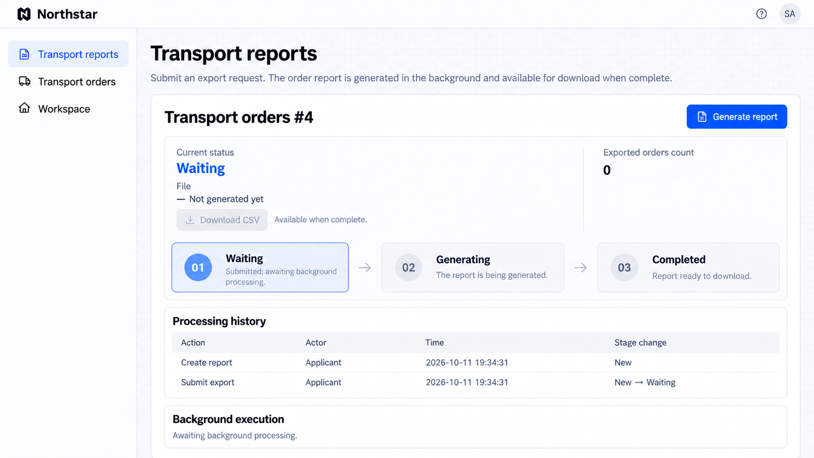
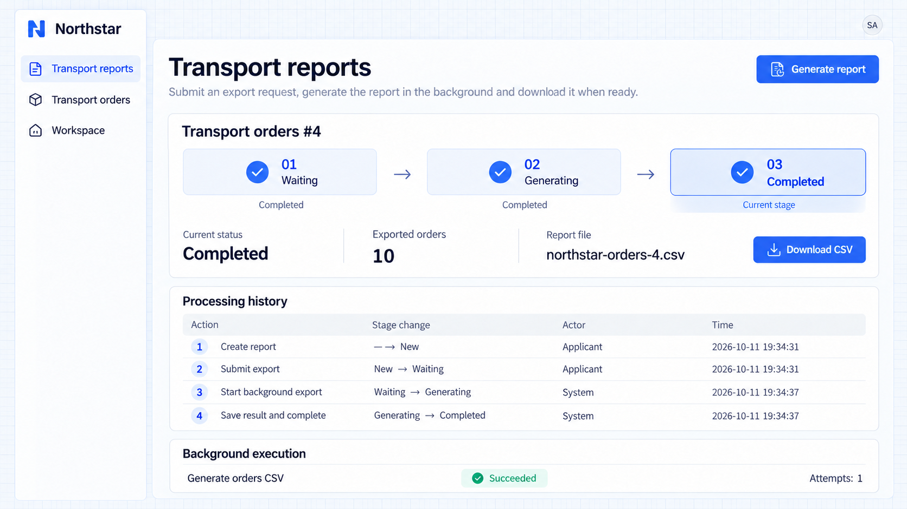

# Chờ, hết thời gian và thực thi tin cậy

Workflow có thể tạm dừng để chờ một người, một kết quả từ bên ngoài hoặc một thời hạn, rồi tiếp tục. Trạng thái chờ được lưu lại để việc xử lý có thể tiếp tục sau khi ứng dụng khởi động lại.

Các lời gọi ra bên ngoài thất bại có thể được ghi lại và thử lại. Kết quả lặp lại không được đẩy cùng một nghiệp vụ đi tiếp hai lần, và kết quả đến muộn được xử lý theo giai đoạn hiện tại. Thất bại xảy ra sau đó cũng có thể cần thao tác bù trừ, chẳng hạn giải phóng xe hoặc chỗ trong kho đã giữ.

## Các cơ chế chờ và xử lý lỗi được hỗ trợ

| Năng lực                 | Mục đích                                                                                             |
| -------------------------- | --------------------------------------------------------------------------------------------------- |
| Chờ một người          | Một phiếu yêu cầu chờ khách hàng trả lời rồi tiếp tục; đến hạn có thể đóng hoặc chuyển cấp.           |
| Chờ kết quả từ bên ngoài  | Các yêu cầu xuất hóa đơn, ký và xuất dữ liệu chờ callback hoặc định kỳ hỏi kết quả.                         |
| Tiến triển theo thời hạn       | Hủy, gia hạn hoặc chuyển cấp khi đến hạn mà không cần mở trang trên trình duyệt.                         |
| Thử lại và bù trừ       | Thử lại khi thất bại, giao thất bại cuối cùng cho người xử lý và hoàn tác các lần giữ chỗ trước đó khi cần.          |
| Tránh xử lý trùng lặp | Loại bỏ yêu cầu hoặc sự kiện lặp lại và ngăn kết quả đến muộn đảo ngược tiến độ đã hoàn tất. |

## Ví dụ: xuất đơn vận chuyển ở chế độ nền

Khi việc xuất dữ liệu mất thời gian, hãy gửi một tác vụ để xử lý nền rồi tải kết quả về sau. Người dùng có thể rời trang và quay lại sau để xem tiến độ và tệp.

```text
Add a Northstar transport report page that exports current orders to CSV.
Queue the submitted report for background generation, then complete it automatically and provide a download.
Show the current stage, filename, exported order count and applicant/system processing history.
Retry generation failures according to policy and retain final failures for follow-up. Repeated execution must not create duplicate report files.
Retain progress and results after refresh, and allow only authorized people to export orders.
```

## Xem kết quả thực thi

### 1. Gửi để xử lý nền

Mở **Báo cáo vận tải** và chọn **Tạo báo cáo**. Báo cáo mới chuyển sang **Đang chờ**, với các bước tạo và gửi trong lịch sử. Tệp chưa thể tải xuống.



**Tác vụ đã được gửi và trạng thái chờ được lưu lại trong khi quá trình xử lý nền tiếp tục.**

### 2. Tải báo cáo đã hoàn tất

Khi tạo xong, trạng thái tự động chuyển thành **Đã hoàn tất**. Trang hiển thị **10** đơn hàng đã xuất và tên tệp. **Tải CSV** sẽ tải báo cáo đã tạo.



**Hệ thống đã tạo một tệp CSV có thể tải xuống và giữ lại bản ghi chờ, xử lý và hoàn tất.**

**Lịch sử xử lý** ghi các thao tác tự động là **Hệ thống**. **Thực thi nền** hiển thị **Thành công** và số lần thử thực tế. Lần chạy này thành công ngay lần thử đầu tiên. Trạng thái hoàn tất và nút tải xuống vẫn còn sau khi mở lại trang.

## Áp dụng các năng lực cho vận tải

Các năng lực này cũng hỗ trợ xuất hóa đơn, xuất dữ liệu hằng tháng, giữ chỗ và phiếu xử lý sự cố. Hãy chỉ rõ cần chờ gì, khi nào hết thời gian và điều gì xảy ra sau khi thất bại.

| Yêu cầu                    | Quy tắc cần định nghĩa                                                                    |
| ------------------------------ | ---------------------------------------------------------------------------------- |
| Xuất hóa đơn hoặc xuất dữ liệu hằng tháng   | Callback hoặc hỏi định kỳ, giới hạn thời gian chờ, thử lại và nơi hiển thị kết quả.           |
| Giữ xe hoặc giữ chỗ   | Có giải phóng khi thất bại về sau không và cách thử lại hoặc chuyển cấp khi giải phóng thất bại. |
| Xác nhận kho và chi phí | Có cần cả hai điều kiện không và thứ tự của chúng có thể thay đổi không.             |
| Theo dõi của đơn vị vận chuyển               | Sự kiện trùng lặp và đến muộn, và kết quả nào đẩy quy trình đi tiếp.                  |
| Phiếu xử lý sự cố              | Thời hạn trả lời, mở lại và yêu cầu phân công lại.                          |

:::tip Lưu ý quan trọng

Thông báo là một năng lực mà Workflow có thể gọi. Workflow kiểm soát việc chờ, tiến độ và xử lý lỗi. Gửi tin nhắn thành công không có nghĩa là nghiệp vụ đã hoàn tất, và gửi thất bại không được làm mất kết quả nghiệp vụ đã lưu. Hãy xác định cách thử lại để tránh thanh toán, hóa đơn hoặc giữ chỗ trùng lặp.

:::

## Định nghĩa thời hạn và khôi phục

Chỉ rõ khi nào thời hạn bắt đầu, phân công lại hoặc nộp lại có tính lại thời hạn không, và có nhắc nhở trước khi chuyển cấp hay không. Bản ghi đã hoàn tất không được nhận nhắc nhở chờ. Định nghĩa giới hạn số lần thử lại, ai xử lý thất bại cuối cùng và cách đối soát kết quả trùng lặp, đến muộn hoặc không xác định. Yêu cầu Agent xây dựng trang khôi phục nếu cần, theo đúng trách nhiệm và quyền yêu cầu.

```text
For Northstar orders awaiting acceptance, remind dispatch after 30 minutes and escalate to the duty manager after 60. Reassigning the driver restarts the deadline; departed orders receive no acceptance reminders. Record automatic actions with reasons and System as the actor. Application restarts must not lose due handling.
Retry failed transport report generation 3 times, then show the reason on the report page for an authorized manager to retry. Repeated requests must not create duplicate reports. Handle duplicate or late carrier notifications according to current progress without reopening cancelled orders; reconcile unknown results before retrying. Confirm the expected outcomes first.
```

Kiểm tra thời hạn, việc xử lý sau khi khởi động lại, kết quả trùng lặp và đến muộn, thất bại cuối cùng và khôi phục thủ công, cũng như trường hợp thực thi thành công.
