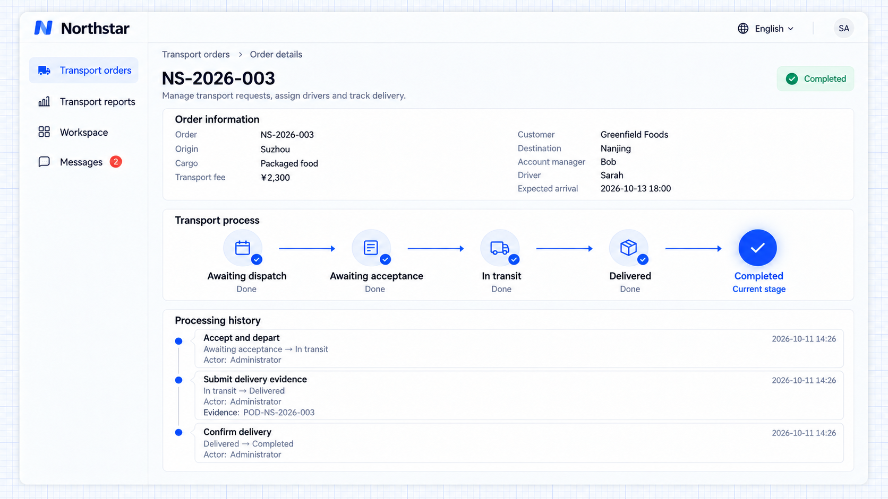

# Tiến độ và lịch sử xử lý

Workflow cung cấp giai đoạn hiện tại, các đường đã đi qua và lịch sử xử lý. Người dùng có thể thấy một bản ghi đang ở đâu, đang chờ gì, và ai đã thực hiện từng thao tác, vào lúc nào và với thông tin gì.

Ứng dụng có thể hiển thị thông tin này dưới dạng sơ đồ quy trình, thanh giai đoạn hoặc danh sách lịch sử trong trang chi tiết nghiệp vụ. Sơ đồ quy trình thể hiện tiến độ thực thi; nó không phải là trình thiết kế quy trình kéo thả.

## Ví dụ: xem lịch sử giao hàng của đơn hàng

Giữ lại tiến độ và từng thao tác trên trang đơn hàng của Northstar để nhân viên kiểm tra bằng chứng giao hàng và hiểu đơn hàng đã đi đến giai đoạn hiện tại như thế nào.

```text
Show the current workflow stage and processing history in Northstar order details.
Record the actor, timestamp, action, previous and next stages, and rejection reason or delivery evidence.
Mark automatic actions as performed by the system.
Keep progress and history after refresh so the delivery process can be reviewed after completion.
```

## Xem kết quả

Sau các bước nhận đơn và xuất phát, nộp bằng chứng giao hàng và xác nhận cuối cùng, đơn **NS-2026-003** ở trạng thái **Đã hoàn tất**. **Lịch sử xử lý** hiển thị ba thao tác thực tế, các lần thay đổi giai đoạn, thời điểm và thông tin đã nộp.



**Đơn hàng đã hoàn tất, các thao tác, thay đổi giai đoạn và bằng chứng giao hàng vẫn có thể xem lại.**

Ví dụ vận tải này dùng thanh giai đoạn và danh sách lịch sử. [Ví dụ xuất dữ liệu nền](./execution.md#xem-kết-quả-thực-thi) cũng hiển thị các thao tác tự động của hệ thống và kết quả của chúng. Bố cục trang có thể được thiết kế tự do theo nhu cầu nghiệp vụ.

:::tip Lưu ý quan trọng

Với một quy trình bị kẹt, hãy kiểm tra trước giai đoạn hiện tại, các điều kiện cần thiết và lịch sử gần nhất. Với lời gọi ra bên ngoài, hãy kiểm tra thêm trạng thái thành công và thử lại. Trước khi thay đổi một quy trình đang chạy, hãy lên kế hoạch cho cách các bản ghi chưa hoàn tất tiếp tục, và giữ lại kết quả đã nộp cùng lịch sử.

:::

Xem [Tài liệu tham khảo cho lập trình viên](./extension.md) khi xem xét các API triển khai.

## Trang và nghiệm thu nghiệp vụ

Danh sách lọc theo giai đoạn; trang chi tiết hiển thị tiến độ, thao tác khả dụng, lý do từ chối, thông tin đã nộp và lịch sử. Hàng đợi công việc của mỗi vai trò chứa các tác vụ của riêng vai trò đó và cập nhật khi người khác thao tác. Hãy thiết kế trang theo nghiệp vụ mà không cần một giao diện quản lý Workflow riêng.

```text
Northstar's dispatch workbench shows orders awaiting assignment or acceptance. Drivers see only their own orders awaiting acceptance or in transit. Details show the current stage, actions and refusal reasons, plus actors, times, stage changes and information in history. Update progress when others act without overwriting their results.
Before release, give me verification results for delivery, refusal and redispatch, cancellation, deadlines, external failures and duplicate notifications. Unrelated people cannot view or act. Explain remaining problems and the production deadlines, recipients and permissions I need to confirm.
```

## Thay đổi trên production và xử lý sự cố

Quy tắc nằm trong ứng dụng và cần triển khai lại sau khi thay đổi. Trước tiên hãy xác định các đơn chưa hoàn tất và công việc bên ngoài đang chờ, đồng thời giải thích tác động của quy tắc mới. Sắp xếp đường đi cho các bản ghi hiện có trước khi đổi tên hoặc xóa một giai đoạn. Các chỉnh sửa có thẩm quyền vẫn giữ lại lịch sử.

```text
Add an "awaiting departure" stage between awaiting acceptance and in transit for Northstar, which has unfinished orders in production. Explain whether one deployment is enough, how existing orders continue and how pending work and history are preserved. Implement after confirmation and give me verification results.
If an order remains in a stage for over a day, investigate its conditions, latest actions and external execution results. Give me the cause and recommendation without changing data yet. I will provide the order number, my identity, action, expected result and actual page error.
```

Xác nhận thời hạn, người phụ trách, quyền, thông báo và tài khoản bên ngoài trên production trước khi phát hành. Kiểm tra mẫu để chắc rằng các bản ghi chưa hoàn tất vẫn tiếp tục được sau khi triển khai.
