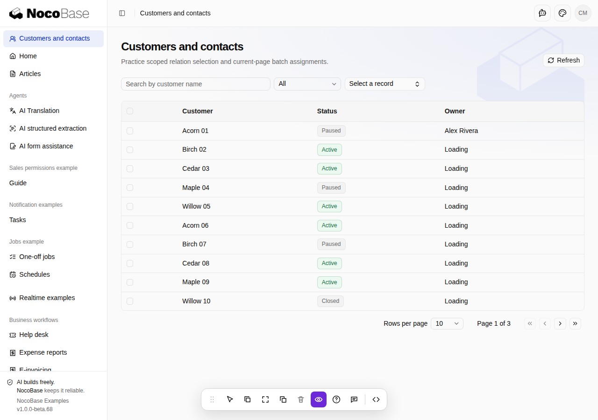
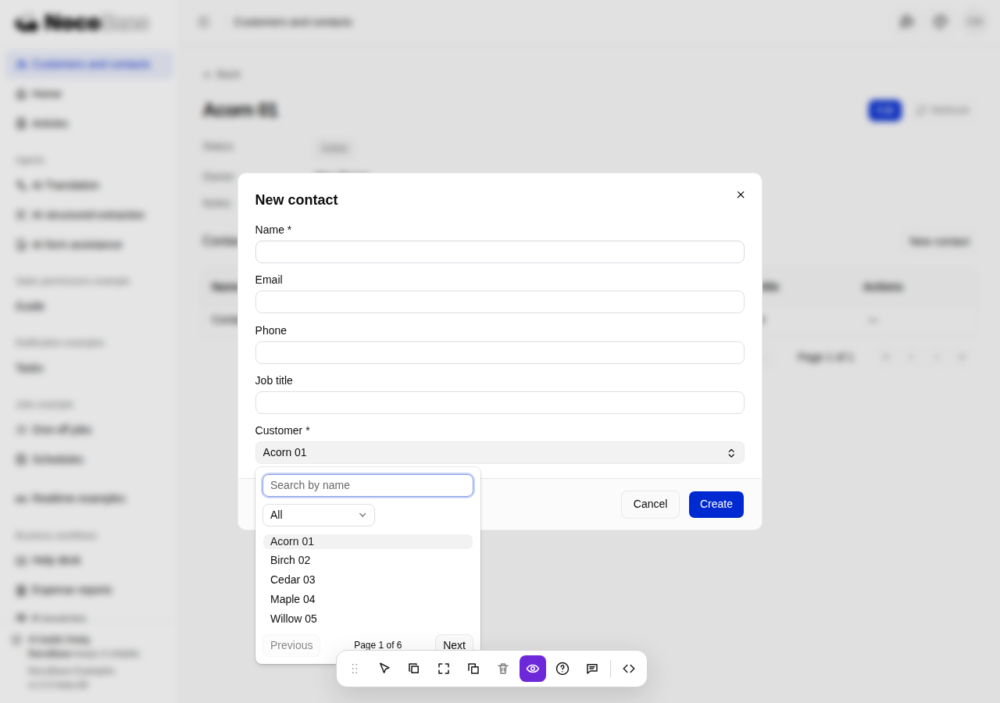
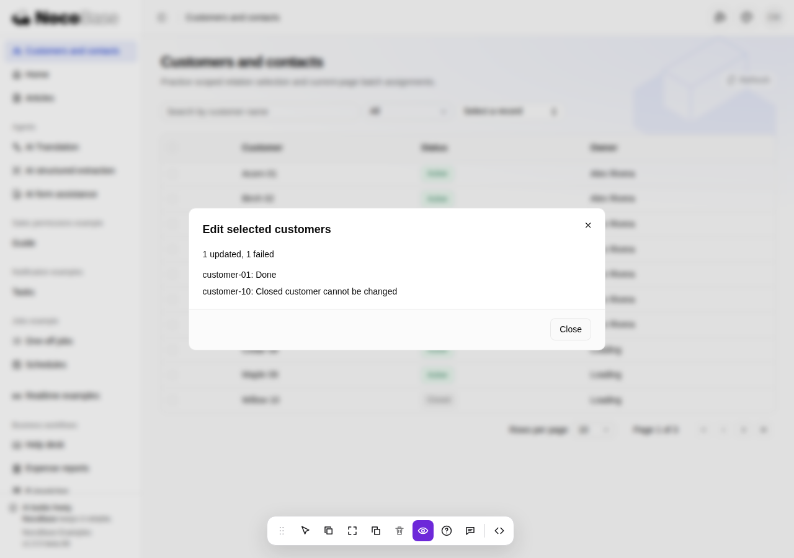
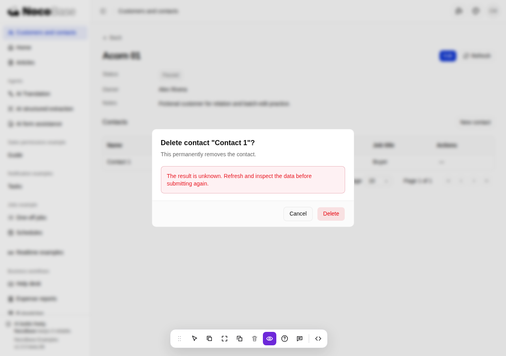

# Customers and contacts example

This application-owned example demonstrates scoped relation selection and current-page batch assignments. Open **Customers and contacts** on the Examples homepage or sidebar (`/customer-contacts`, relative to the printed application base URL). Use a dedicated Examples database and configuration; never copy Default or another application's runtime state.

## Install, start and test

From the NocoBase source repository root, run `pnpm install`. Then, from `packages/templates/app-template-examples`:

```bash
pnpm nocobase config init --dialect sqlite
pnpm nocobase config check
pnpm nocobase db apply --dry-run --json
pnpm nocobase db apply --json
pnpm dev
```

For a generated Examples application, run `pnpm install` from that application's root and use the same configuration/start commands. `config init` is needed only when configuration does not exist. Use the **Local:** URL printed by `pnpm dev`, including its base path and server port. SQLite needs no separate database server. Initialization adds three example collections and demonstration users; it does not alter the inherited member role or authenticated default access.

| Fictional account          | Password            | Responsibility                                                              |
| -------------------------- | ------------------- | --------------------------------------------------------------------------- |
| crm_manager@example.test   | CustomerExample123! | View all, edit details/status, assign active owners, maintain contacts      |
| crm_rep@example.test       | CustomerExample123! | View own customers and contacts, edit details/status, maintain own contacts |
| crm_colleague@example.test | CustomerExample123! | Same representative role, a separate customer scope                         |

These publicly documented learning accounts belong only in an isolated Examples application. Remove demonstration accounts and replace installation data before adapting this code into a production business application. Administrators manage direct assignments in **Users** and grants in **Roles and permissions**; role definitions remain editable. The unrestricted root administrator can open every example and reset its business data.

```bash
pnpm exec vitest run tests/client/customer-contacts.test.tsx tests/server/customer-contacts.test.ts tests/database/customer-contacts-migration.test.ts tests/server/authorization-assignment-safety.test.ts tests/client/page-permission-titles.test.ts
pnpm typecheck
pnpm build
```

The tests use disposable databases and native sign-in; they do not use this development database. In a source checkout, also run `node scripts/sync-app-skill-examples.mjs --check` and `node --test tests/scripts/app-skill-examples.test.mjs` from the repository root.

## Try the interaction

Search by customer name, filter by status or permitted owner, and navigate pages. Open a customer's name to view its details and maintain contacts. Contact editors resolve the current customer through a protected detail endpoint; their picker supports name search, status filters and server pagination. The manager can choose active owners from the same protected picker pattern. Inaccessible selected records show only **Record unavailable**. Saving always rechecks both source and target permission scopes.

Select customers on the current page and open **Edit selected customers**. Choose exactly one field, status or owner, and review the displayed count before applying. Changing page/query or refreshing clears selection. A completed request shows one outcome per submitted id and exact success/failure counts. Closed customers are readable but reject changes, including contact changes. Representatives cannot assign owners. Unknown fields and invalid values reject the whole request, while an otherwise valid mixed-scope request can succeed for permitted rows and report the other ids as unavailable. No hidden record names are fetched for failure reporting.

The API lives under `/api/customerContacts` and is documented in the running application's `/api/swagger/docs`. Batch accepts `{ ids: string[], values: { status } | { ownerId } }`, at most 100 unique ids. It uses the single-record permission and mutation implementation, one business transaction and no persistent receipt or operation key. Unexpected write errors roll back that transaction. After a lost response the result is unknown: refresh and inspect the data before explicitly submitting again. A new request checks current access and state again.

## Reset only this example

Sign in as the unrestricted administrator and use **Reset example data**, then confirm. This replaces only exampleSalesReps, exampleCustomers and exampleContacts with their original fictional dataset. It preserves accounts, administrator-edited permissions, assignments and other examples. The corresponding authenticated endpoint is `POST /api/customerContacts/reset`; ordinary business roles receive 403. A whole-database `db reset` is unnecessary and would remove unrelated application data.

## Reuse and independent acceptance

The [page design and acceptance criteria](ui/pages/customer-contacts.md) describe the UI contract. The synchronized [relation/batch reference](../.agents/skills/nocobase-app-development/references/frontend/references/executable-relation-batch.md) provides independent entry points, dependencies, source registration and adaptation guidance. Canonical source is under `client/pages/customer-contacts/`, `server/providers/customer-contacts*`, `server/routes/customer-contacts.ts`, the matching migration/seed and the three test suites. Edit canonical source first, then synchronize the Skill assets from the repository root; do not maintain a second implementation in generated Skills.

For independent Default acceptance, substitute another business object such as suppliers, use separate native identities/data scopes and record requirements, installed versions, commands, observed data and manual corrections. Verify search/paging, permitted association changes, hidden source/target rejection, full/partial batch outcomes and illegal fields against actual saved rows. Record this separately from the example's own tests; shared baseline measurement and combined scenario acceptance belong to their own work.

## Screenshots

These English screenshots show the running Examples application with fictional data. The failed-delete view uses a simulated unavailable response without deleting the contact.








